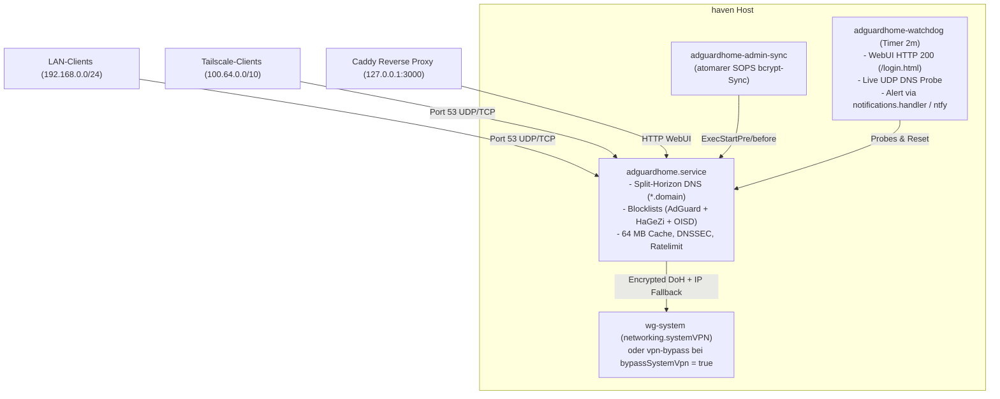

# `server.adguard` – Network-Wide AdGuard Home, Split-Horizon DNS & Auto-Healing

Das Modul `server.adguard` betreibt AdGuard Home als netzwerkweiten DNS-Blocker mit DoH-Upstreams, Split-Horizon-DNS für LAN & Tailscale, atomarem SOPS-Admin-Sync, `systemVPN`-Integration, autonomem Watchdog inkl. Anti-Spam-Benachrichtigungen sowie einer eigenen Diagnose-CLI (`adguard`).

---

## 1. Architektur-Übersicht



---

## 2. Alle NixOS-Optionen (`server.adguard.*`)

| Option | Typ | Standardwert | Beschreibung |
| :--- | :--- | :--- | :--- |
| `enable` | `bool` | `false` | Aktiviert AdGuard Home, Firewall-Port `53` und Deaktivierung von `systemd-resolved` `DNSStubListener`. |
| `port` | `port` | `3000` | Interner HTTP-Port für Dashboard und API (`127.0.0.1:<port>`). |
| `subdomain` | `str` | `"adguard"` | Reverse-Proxy-Subdomain (`adguard.<domain>`). |
| `lanIp` / `tailscaleIp` | `nullOr str` | `null` | Ziel-IPs für Split-Horizon-DNS (`*.<domain>`). |
| `lanSubnet` / `tailscaleSubnet` | `str` | `"192.168.0.0/24"` / `"100.64.0.0/10"` | Client-Subnetze zur Unterscheidung der Split-Horizon-Antworten. |
| `routerIp` | `str` | `"192.168.0.1"` | LAN-Gateway für lokale Reverse-DNS-Auflösung (PTR). |
| `upstreamDns` | `listOf str` | Quad9, Cloudflare, `dns.mullvad.net` | Ungefilterte DoH-Resolver (verhindert inkonsistentes Blocken im `parallel`-Modus). |
| `fallbackDns` | `listOf str` | `["https://1.1.1.1/dns-query" "https://9.9.9.9/dns-query"]` | IP-basierte DoH-Fallbacks bei Bootstrap-/Upstream-Problemen. |
| `upstreamMode` | `enum` | `"parallel"` | `parallel`, `load_balance` oder `fastest_addr`. |
| `bypassSystemVpn` | `bool` | `false` | `false`: DoH zusätzlich durch `wg-system` getunnelt (Wartung auf `wg-system` beim Boot). `true`: läuft in `vpn-bypass` direkt über `eno1`. |
| `ratelimit` | `int` | `300` | Abfragen/Sekunde pro Client (`127.0.0.1` & `::1` sind gewhitelistet). |
| `querylogInterval` | `str` | `"30d"` | Aufbewahrungsdauer des Query-Logs. |
| `safeSearch.*` | `bool` | `enable = true`, `youtube = false` | Erzwingt SafeSearch für Google, Bing, DuckDuckGo, Ecosia, Pixabay, Yandex (YouTube standardmäßig aus). |
| `rewrites` | `listOf submodule` | `[]` | Deklarative Custom-DNS-Einträge (`domain`, entweder `answer` oder `lanAnswer`/`tailscaleAnswer`, `includeSubdomains`). |
| `watchdog.enable` / `interval` / `failureThreshold` | `bool` / `str` / `int` | `true` / `"2m"` / `3` | Periodische Prüfung von WebUI und Live-DNS inkl. automatischem Neustart. |
| `notifications.enable` / `handler` | `bool` / `str \| package` | `config.server.notify.enable or false` / `null` | Einmal-Benachrichtigungen bei Ausfall & Recovery (`$1` = Nachricht, `$2` = Tag). |

---

## 3. Dauerbetriebs- & Setup-Anpassungen

- **Keine Block-Races mehr im Upstream:** `adblock.doh.mullvad.net` wurde durch das ungefilterte `https://dns.mullvad.net/dns-query` ersetzt, damit lokale AdGuard-Allow-/Blocklists im `parallel`-Modus deterministisch greifen.
- **Sauberer Start mit `systemVPN`:** Wenn `bypassSystemVpn = false` ist, wartet `adguardhome.service` auf `wg-quick-<iface>.service`, statt beim Boot Bootstrap-Timeouts in den geschlossenen Killswitch zu feuern; `fallback_dns` fängt transiente Ausfälle ab.
- **Split-Horizon ohne IPv6-Leak:** `$dnsrewrite=NOERROR;A;<ip>` beantwortet `A` lokal (inkl. `127.0.0.1|::1`) und `AAAA` mit `NOERROR`/0 Antworten.
- **Sichere Limits & Atomarer Admin-Sync:** `MemoryHigh = "1G"`, `MemoryMax = "1536M"` (passend für ~1,77 Mio. Filterregeln), `StartLimitIntervalSec = 0` sowie atomarer YAML-Sync in [sync-admin.py](file:///home/luka/dotfiles/modules/system/server/adguard/scripts/sync-admin.py).

---

## 4. CLI-Referenz (`adguard`)

```bash
adguard status   # Service/Sync/Watchdog, Egress-Modus, Version, Queries/Blocked %, Avg ms, Filterregeln, Split-Horizon
adguard check    # 9-Punkte-Self-Test: Units, Port 53, StubListener aus, API-Auth, Filter, Adblock-Test, Live-DNS, Split-Horizon A/AAAA
```
