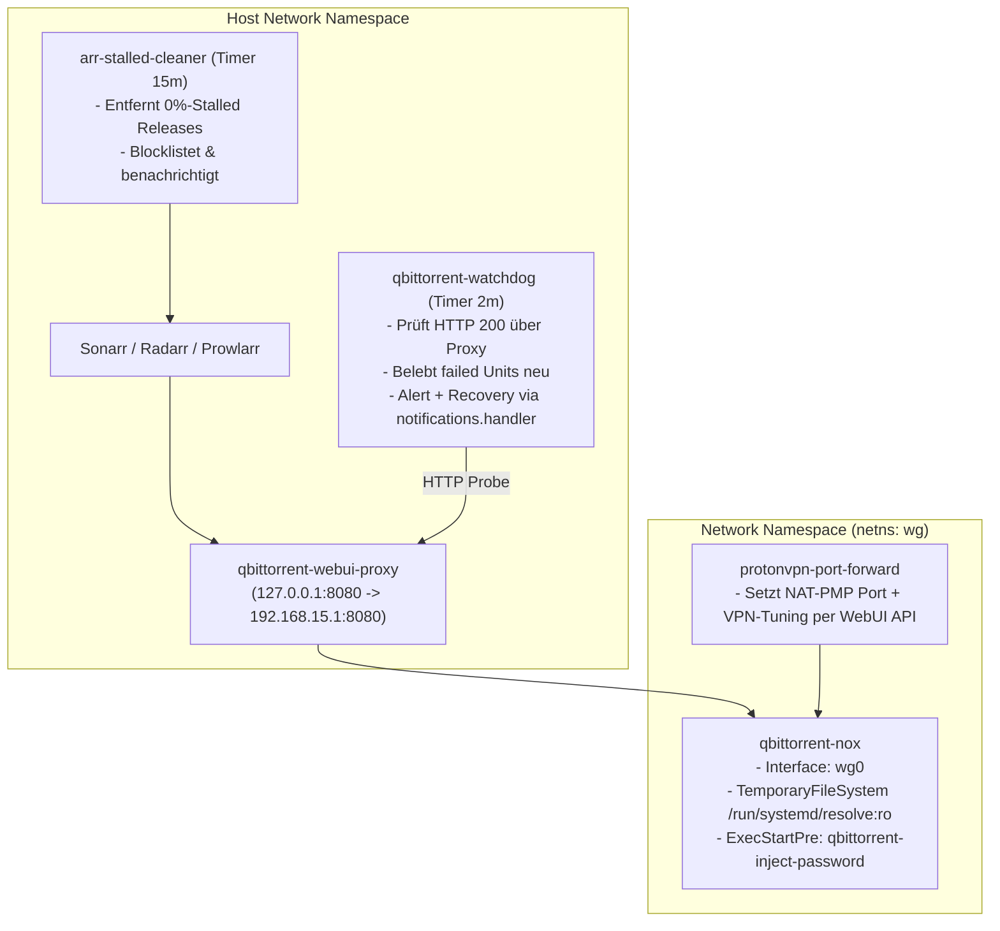

# `server.arr.qbittorrent` – VPN-integrierter qBittorrent & Auto-Healing Handbuch

Das Modul `server.arr.qbittorrent` konfiguriert `qbittorrent-nox` deklarativ über `nixflix`, koppelt ihn strikt an den WireGuard-Namespace aus `server.arr.vpn`, synchronisiert das SOPS-Passwort atomar beim Start, bereinigt tote Downloads über die Arr-Queues und überwacht die Erreichbarkeit mit eigenem Host-Watchdog samt Benachrichtigungen.

---

## 1. Architektur-Übersicht



---

## 2. Alle NixOS-Optionen (`server.arr.qbittorrent.*`)

| Option | Typ | Standardwert | Beschreibung |
| :--- | :--- | :--- | :--- |
| `enable` | `bool` | `true` | Aktiviert den qBittorrent-Downloadclient. |
| `webuiPort` | `port` | `8080` | WebUI-Port (im Namespace sowie über den Host-Proxy). |
| `subdomain` | `str` | `"qbit"` | Reverse-Proxy-Subdomain. |
| `username` | `str` | `cfg.adminUser` | Benutzername für das WebUI. |
| `maxActiveDownloads` / `maxActiveTorrents` | `int` | `3` / `5` | Parallele aktive Downloads und Gesamttorrents. |
| `maxConnections` / `maxConnectionsPerTorrent` | `int` | `200` / `50` | Globales und Torrent-bezogenes Verbindungslimit. |
| `maxUploads` / `maxUploadsPerTorrent` | `int` | `8` / `2` | Upload-Slots (auf kompakte Upload-Limits abgestimmt). |
| `downloadRateLimitKiB` / `uploadRateLimitKiB` | `int` | `0` / `0` | Globale Download-/Upload-Limits in KiB/s (`0` = unbegrenzt). |
| `connectionSpeed` / `socketBacklogSize` | `int` | `50` / `100` | Verbindungsaufbau/s und Listen-Backlog für NAT-PMP-Bursts. |
| `diskCacheSizeMiB` | `int` | `512` | RAM-Schreibcache in MiB (`MemoryHigh = 2G`, `MemoryMax = 4G`). |
| `hashingThreads` / `saveResumeDataInterval` | `int` | `2` / `15` | Hash-Threads und Fast-Resume-Speicherintervall (Minuten). |
| `announceToAllTrackers` / `pieceExtentAffinity` / `coalesceReadWrite` | `bool` | `true` | Tracker-Announces über alle Tiers und sequentielle I/O-Optimierung. |
| `seedRatioLimit` / `maxSeedingMinutes` | `nullOr number/int` | `null` | Stoppt Seeding automatisch bei Erreichen (`0.0` = sofort stoppen). |
| `watchdog.enable` / `interval` / `failureThreshold` | `bool` / `str` / `int` | `true` / `"2m"` / `3` | Host-Watchdog für WebUI-Erreichbarkeit und `failed`-Recovery. |
| `stalledCleaner.enable` / `maxStalledMinutes` / `interval` | `bool` / `int` / `str` | `true` / `20` / `"*:0/15"` | Entfernt und blocklistet 0%-Stalled-Torrents in Sonarr/Radarr. |
| `notifications.enable` | `bool` | `config.server.notify.enable or false` | Sendet Watchdog-Ausfälle, Recoveries und Stalled-Bereinigungen. |
| `notifications.handler` | `nullOr (str \| package)` | `null` | Eigener Handler (`$1` = Nachricht, `$2` = Tag). Default: lokales `ntfy`. |

---

## 3. VPN- & Dauerbetriebs-Optimierungen

- **Sofortiger Re-Announce bei VPN-Wechsel:** `reannounce_when_address_changed = true` informiert Tracker sofort nach `wg-watchdog`-Neustarts oder NAT-PMP-Portwechseln, statt auf das 30-Minuten-Intervall zu warten.
- **Kein LAN-Multicast im Tunnel:** `lsd = false`, `upnp = false` und `resolve_peer_host_names = false` verhindern nutzlosen Multicast-Traffic auf `0.0.0.0:6771`, UPnP-Anfragen und Reverse-DNS-Fluten.
- **Sauberer TCP-Vorrang:** `utp_tcp_mixed_mode = 0` (`Prefer TCP`) und `limit_tcp_overhead = false` verhindern, dass Download-ACKs durch ein Upload-Limit abgewürgt werden.
- **Kein Start-Limit-Lockout:** `qbittorrent.service` nutzt `StartLimitIntervalSec = 0` mit Backoff bis `1m`; der Host-Watchdog belebt `failed` Units selbstständig neu und respektiert gleichzeitig `wg.service`-Neustarts.
- **Passwort-Sync ohne Nix-Store-Leak:** `qbittorrent-inject-password` hasht `services_password` per PBKDF2-HMAC-SHA512 direkt in `qBittorrent.conf`, nur wenn sich das Passwort geändert hat.

---

## 4. CLI-Referenz (`arr qbit` / `arr-qbit`)

```bash
arr qbit status   # Service/Proxy/Watchdog-Status, API-Speed, aktive/stalled Torrents, Interface & Port, Speicher
arr qbit check    # Self-Test: Services, HTTP-200 + API-Auth, wg0-Binding, VPN-Tuning, NAT-PMP-Port-Abgleich, Berechtigungen
```
