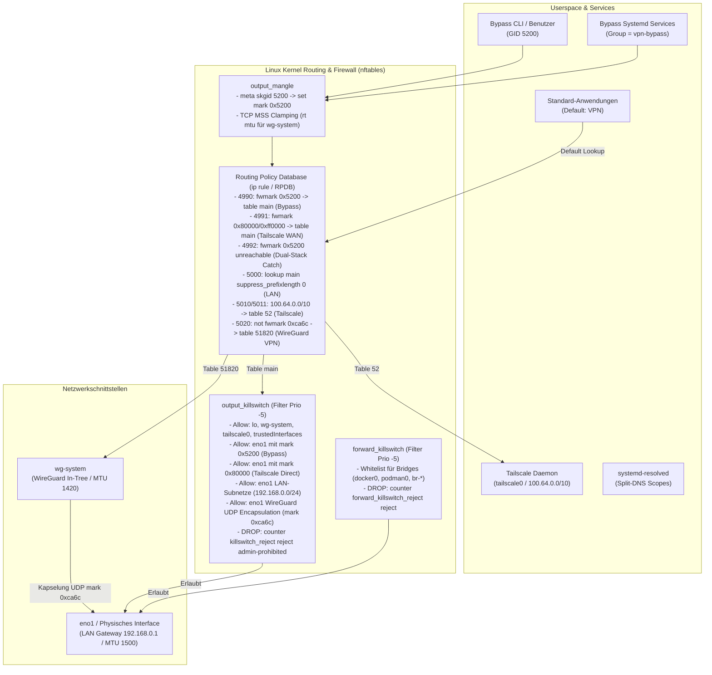

# `networking.systemVPN` – Vollständiges Funktions- und Referenzhandbuch

Das Modul `networking.systemVPN` implementiert ein manipulationssicheres, Kernel-integriertes VPN-Routing-System auf NixOS mit nativer `nftables`-Firewall, deterministischem Policy-Routing (RPDB), Fail-Closed Leak-Prevention, Split-Tunneling und autonomer Selbstheilung.

---

## 1. Architektur-Übersicht



---

## 2. Alle NixOS-Optionen (`networking.systemVPN.*`)

Die Konfiguration erfolgt deklarativ in NixOS über `networking.systemVPN`:

| Option | Typ | Standardwert | Beschreibung |
| :--- | :--- | :--- | :--- |
| `enable` | `bool` | `false` | Aktiviert das System-VPN-Modul, den nftables-Killswitch, die Policy-Routen und den Watchdog. |
| `interfaceName` | `str` | `"wg-system"` | Name der virtuellen WireGuard-Schnittstelle im Kernel. |
| `physicalInterface` | `nullOr str` | `null` | **Pflichtangabe**: Name des physischen Netzwerkadapters (z. B. `"eno1"` oder `"eth0"`), über den das Gateway erreichbar ist. |
| `wgConfFile` | `nullOr str` | `null` | **Pflichtangabe**: Absoluter Dateipfad zur WireGuard-Konfigurationsdatei (z. B. aus SOPS-Secrets `/run/secrets/wireguard_system`). **Kein** Nix-Pfadliteral verwenden, um Secret-Leaks im `/nix/store` zu verhindern. |
| `lanSubnets` | `listOf str` | `["192.168.0.0/16" "172.16.0.0/12"]` | Subnetze, die für direkte LAN-Kommunikation ohne VPN freigegeben sind (unterstützt IPv4 und IPv6). |
| `trustedInterfaces` | `listOf str` | `[]` | Lokale Schnittstellen für Container/VMs (z. B. `["docker0" "podman0" "br-*" "virbr0"]`), die vom Killswitch und NetworkManager freigegeben werden. |
| `extraTunnelInterfaces` | `listOf str` | `[]` | Zusätzliche Tunnel- oder Bridge-Interfaces (z. B. `["wg0" "veth-*"]`), die unverschlüsselt am Killswitch vorbei kommunizieren dürfen. |
| `tailscaleInterface` | `str` | `"tailscale0"` | Name des Tailscale-Netzwerkgeräts. Wird automatisch freigegeben, wenn `services.tailscale.enable = true` ist. |
| **`bypass.enable`** | `bool` | `true` | Aktiviert das GID-basierte Split-Tunneling über Linux-Gruppen. |
| `bypass.group` | `str` | `"vpn-bypass"` | Name der Linux-Gruppe (statische GID `5200`), deren Prozesse am VPN vorbei direkt über das LAN-Gateway routen. |
| `bypass.users` | `listOf str` | `[]` | Liste von Benutzernamen, die automatisch der Bypass-Gruppe hinzugefügt werden sollen. |
| `bypass.services` | `listOf str` | `[]` | Liste von systemd-Dienstnamen (z. B. `["jellyfin.service"]`), die mit primärer GID `vpn-bypass` gestartet werden. |
| **`splitDns.enable`** | `bool` | `true` | Aktiviert per-Interface Split-DNS über `systemd-resolved`. Erzwingt Fail-Closed-Verhalten ohne ISP-DNS-Leaks. |
| `splitDns.localDomains` | `listOf str` | `["~local" "~home.arpa" "~lan"]` | Domain-Scopes, die an das physische Interface und den lokalen LAN-DNS-Server geroutet werden. |
| **`watchdog.enable`** | `bool` | `true` | Aktiviert den autonomen Systemd-Timer zur Erkennung von toten Peers und Stalled-Routing. |
| `watchdog.interval` | `str` | `"2m"` | Prüfintervall im systemd-Timer-Format (z. B. `"2m"`, `"5m"`). |
| `watchdog.pingTarget` | `str` | `"1.1.1.1"` | IP-Adresse, die exklusiv über das VPN-Interface angepingt wird, um die Egress-Konnektivität zu validieren. |
| `watchdog.maxHandshakeAge` | `ints.positive` | `180` | Maximales Alter des kryptografischen Handshakes in Sekunden vor automatischem Serviceneustart. |
| **`notifications.enable`** | `bool` | `config.server.notify.enable or false` | Aktiviert deduplizierte Ausfall- und Recovery-Benachrichtigungen des Watchdogs. |
| `notifications.handler` | `nullOr (str \| package)` | `null` | Eigener Notification-Handler (`$1` = Nachricht, `$2` = Tag). Default: lokales `ntfy` (`server.notify`). |

---

## 3. Kernfunktionen & Schutzmechanismen im Detail

### 3.1 In-Tree Linux Kernel WireGuard Engine & FwMark-Routing

- **Kernel-Space Performance**: Nutzt das native Kernel-Modul `wireguard.ko` (ChaCha20-Poly1305, Curve25519) anstelle langsamer Userspace-TUN-Treiber.
- **Automatisches Egress-Routing via FwMark `0xca6c`**: Manuelle Endpoint-Hostrouten (`pre-up.sh`) wurden vollständig abgeschafft. Alle verschlüsselten UDP-Tunnelpakete werden vom Kernel mit `fwmark 0xca6c` markiert. Die Routing-Regel `not from all fwmark 0xca6c lookup 51820` schließt diese Pakete aus, sodass sie automatisch über `table main` das physische Gateway verlassen.

### 3.2 Deterministische RPDB-Routing-Hierarchie

Die Routing Policy Database (RPDB) wird über `post-up.sh` und `post-down.sh` mit strikten Prioritäten verwaltet:

```text
4990:  from all fwmark 0x5200 lookup main                     # Split-Tunneling Bypass (GID 5200)
4991:  from all fwmark 0x80000/0xff0000 lookup main          # Tailscale Direct WAN-Bypass (P2P Egress)
4992:  from all fwmark 0x5200 unreachable                    # Dual-Stack Catch: blockiert VPN-Leak bei fehlendem IPv6
5000:  from all lookup main suppress_prefixlength 0          # Lokales LAN (192.168.0.0/24) symmetrisch vor Default-Route
5010:  from all to 100.64.0.0/10 lookup 52                   # Tailscale CGNAT Overlay-Mesh Ziel
5011:  from 100.64.0.0/10 lookup 52                          # Tailscale CGNAT Overlay-Mesh Quelle
5020:  not from all fwmark 0xca6c lookup 51820               # WireGuard VPN Default-Route für den gesamten Rest
5210+: Tailscale-eigene Routing-Regeln                       # Bleiben beim VPN-Start/Stop unberührt erhalten!
```

### 3.3 Universeller nftables Killswitch (`inet system-vpn`)

- Die Filter-Chain `output_killswitch` greift mit Priorität `filter - 5` (vor der Standard-Firewall).
- Ausschließlich explizit gewhitelistete Pakete (Loopback, VPN-Tunnel, LAN-Subnetze, Tailscale, DHCP, WireGuard FwMark `0xca6c`, Bypass Mark `0x5200`) werden akzeptiert.
- **Universeller Reject**: Alle nicht freigegebenen Pakete enden im universellen Reject:

  ```nftables
  counter name "killswitch_reject" reject with icmpx type admin-prohibited;
  ```

  *(Ohne Bindung an ein Interface – schützt auch bei nachträglich eingesteckten USB-Ethernet-Adaptern oder WLAN).*

### 3.4 Container- & VM-Schutz: Forward-Killswitch (`forward_killswitch`)

- Verhindert, dass Container (Docker, Podman) oder VMs unverschlüsselt über das WAN-Interface `eno1` Daten senden.
- Whitelistet lokale Container-Bridges (`trustedInterfaces`) und LAN-Subnetze.
- Schließt mit benanntem Counter ab: `counter name "forward_killswitch_reject" reject with icmpx type admin-prohibited;`.

### 3.5 Selektives Split-Tunneling (Bypass)

- **Über Linux-Gruppen (GID 5200)**: Prozesse, die unter der Gruppe `vpn-bypass` laufen, werden in der `output_mangle`-Chain mit `0x5200` markiert.
- **Systemd Service Integration**: Dienste in `bypass.services` erhalten automatisch `Group = vpn-bypass`.
- **CLI-Wrapper**: Beliebige Befehle können ad-hoc via `system-vpn bypass <command...>` am VPN vorbei ausgeführt werden.
- **SNAT / Masquerading**: Bypasste Pakete werden in `postrouting_nat` automatisch auf die physische LAN-IP maskiert.
- **Prio 4992 Dual-Stack Guard**: Verhindert, dass IPv6-Bypass-Traffic mangels nativer IPv6-Route im LAN versehentlich in den VPN-Tunnel fällt.

### 3.6 Fail-Closed Split-DNS via `systemd-resolved`

- Der VPN-Tunnel erhält den exklusiven globalen Default-DNS-Scope: `resolvectl domain wg-system '~.'` und `resolvectl default-route wg-system yes`.
- Das physische Interface wird für globales DNS gesperrt: `resolvectl default-route eno1 no`.
- Nur interne Domains (`~local`, `~home.arpa`, `~lan`, `~lukpac.dev`) werden an das LAN-Interface weitergeleitet.
- **Fail-Closed bei Tunnelstopp**: `post-down.sh` belässt `DefaultRoute=no` auf `eno1`. Wenn der VPN-Tunnel stoppt, schlagen externe DNS-Anfragen sofort fehl, statt unbemerkt Klartext-Queries an den ISP-Router zu leken.

### 3.7 NetworkManager & systemd-networkd Integration

- WireGuard- und Container-Schnittstellen werden in NetworkManager als `unmanaged` markiert.
- Ein NetworkManager-Dispatcher-Skript sowie direkte Einstellungen im networkd-Profil verhindern, dass DHCP-Lease-Renewals `DefaultRoute=yes` oder ISP-DNS auf dem LAN-Interface wiederherstellen.

### 3.8 Autonomer Selbstheilungs-Watchdog (`system-vpn-watchdog`)

- Ein systemd-Timer (`wg-system-watchdog.timer`) führt alle 2 Minuten einen Integritätstest durch:
  1. Ping-Probe zu `1.1.1.1` streng gebunden an die Tunnelschnittstelle (`ping -I wg-system`).
  2. Prüfung des letzten kryptografischen Handshakes via `wg show`.
  3. **Auto-Recovery**: Überschreitet das Handshake-Alter 180 Sekunden oder schlägt der Ping 3 Mal hintereinander fehl (Stalled Routing trotz aktiver Keepalives), wird `wg-quick-wg-system.service` automatisch neugestartet.
  4. Nach erfolgreicher Wiederherstellung wird der Fehlerzähler gelöscht.

### 3.9 TCP MSS Clamping & PMTU-Blackhole-Schutz

- Die nftables Mangle-Chain führt auf `wg-system` dynamisches TCP MSS Clamping durch:

  ```nftables
  oifname "wg-system" meta mark != 0x5200 tcp flags syn / syn,rst tcp option maxseg size set rt mtu;
  ```

- Garantiert, dass VPN-Traffic (MTU 1420) eine maximale Segmentgröße von 1380 Byte erhält.
- Bypasster Datenverkehr (`meta mark != 0x5200`) wird davon ausgenommen und nutzt die volle MTU 1500 / MSS 1460 des LANs.

### 3.10 Nahtlose Tailscale-Koexistenz

- **RPDB-Regel 4991**: Tailscales Control- und Peer-Traffic (`fwmark 0x80000/0xff0000`) wird vor der VPN-Routing-Tabelle abgefangen und über `table main` direkt über das LAN-Gateway geroutet.
- **Direkte P2P-Verbindungen**: Tailscale muss nicht auf langsame DERP-Relays ausweichen, sondern etabliert direkte UDP-Verbindungen (Port 41641) über das physische WAN.
- **Mesh-Overlay**: Tailscale-CGNAT-Traffic (`100.64.0.0/10`) wird über Prio 5010/5011 deterministisch in `table 52` geroutet.
- **Isoliertes Teardown**: Das Beenden oder Neustarten des VPNs lässt Tailscales Regeln (Prio 5210, 5230, 5250, 5270) unberührt.

### 3.11 Symmetrisches Inbound LAN-Routing & Loose RP-Filter

- Durch RPDB-Priorität 5000 (`lookup main suppress_prefixlength 0`) werden eingehende Verbindungen aus dem lokalen Subnetz (z. B. SSH, Caddy, Jellyfin auf Port 80/443/22) immer über `table main` beantwortet.
- `networking.firewall.checkReversePath = "loose"` stellt sicher, dass der Kernel asymmetrische Antwortpakete aus Split-Tunnel-Routen nicht verwirft.

---

## 4. CLI-Referenz (`system-vpn`)

Das CLI-Tool `system-vpn` kapselt alle Management- und Diagnosewerkzeuge in einem einzigen Befehl:

```bash
system-vpn {status [--fast|--no-ip]|check|start|stop|restart|logs|watchdog|bypass <command...>}
```

### Befehle im Überblick

#### 1. `system-vpn status [--fast|--no-ip]` (oder einfach `system-vpn`)

Öffnet das interaktive Terminal-Dashboard mit strukturierter Telemetrie (`--fast` / `--no-ip` überspringt die externe IP-Abfrage):

- Status des WireGuard-Dienstes und Interface-Uptime.
- WireGuard-Kryptografie: Endpoint, letzter Handshake, Datenübertragung (RX/TX).
- Öffentliche IP-Adressen: Aktive VPN-Egress-IP (inkl. Land/ISP) vs. Direkte Provider-IP.
- Split-Tunneling-Status: GID, aktive Bypass-Benutzer und konfigurierte Bypass-Dienste.
- Split-DNS: Status von `systemd-resolved`, DefaultRoute-Flags, aktive DNS-Server.
- Tailscale-Integration: Direct WAN-Bypass aktiv, Tailscale-Regelstatus.
- Firewall-Telemetrie: Zählerstände der benannten Counter `killswitch_reject` und `forward_killswitch_reject`.
- Watchdog-Status: Nächster Prüfzeitpunkt des Timers und aktuelle Fehlerzähler.

#### 2. `sudo system-vpn check` (bzw. `selftest`)

Führt einen automatisierten 22-Punkte-Validierungstest durch:

- Prüft Existenz und Link-Status des VPN-Interfaces.
- Validiert Kernel-Fwmark (`0xca6c`).
- Prüft Default-Routen in `table 51820` (IPv4 und IPv6).
- Validiert die gesamte RPDB-Regelkette für IPv4 und IPv6 (4990, 4991, 4992, 5000, 5010, 5011, 5020).
- Prüft systemd-resolved DNS-Scopes (`~.` auf VPN, `DefaultRoute=no` auf LAN).
- Führt eine aktive Egress-Sondenprüfung mit `curl --interface "if!$PHYS_IFACE"` durch und verifiziert das Hochzählen des Killswitch-Counters.

#### 3. `system-vpn start` / `stop` / `restart`

Startet, stoppt oder startet den VPN-Dienst `wg-quick-${interfaceName}.service` neu. Beim Stoppen greift der Fail-Closed-Schutz; beim Starten werden alle RPDB-Regeln idempotent neu erzeugt.

#### 4. `system-vpn logs`

Gibt die letzten 50 Zeilen der kombinierten Systemd-Journale des WireGuard-Tunnels und des Watchdogs aus.

#### 5. `system-vpn watchdog`

Löst manuell einen sofortigen Durchlauf des Connectivity- und Handshake-Watchdogs aus.

#### 6. `system-vpn bypass <command...>`

Führt den angegebenen Befehl transparent über die physische Internetverbindung außerhalb des VPNs aus.

```bash
# Beispiel: Eigene Provider-IP ermitteln
system-vpn bypass curl -s https://ifconfig.me

# Beispiel: Befehl als Benutzer mit Bypass-Rechten ausführen
system-vpn bypass speedtest
```

---

## 5. Konfigurations-Voraussetzungen & Best Practices

### 5.1 WireGuard-Konfigurationsdatei (`wgConfFile`)

Damit das Zusammenspiel mit `networking.systemVPN` reibungslos funktioniert, muss die WireGuard-Konfigurationsdatei folgende Kriterien erfüllen:

1. **Endpoint als numerische IP-Adresse**:

   ```ini
   [Peer]
   Endpoint = 198.51.100.1:51820  # Numerische IP verwenden (kein Domainname!)
   ```

   *Hintergrund*: Vor dem Tunnelstart verhindert der Fail-Closed-DNS-Schutz das Auflösen von öffentlichen Domainnamen.
2. **AllowedIPs für vollen Tunnelverkehr**:

   ```ini
   AllowedIPs = 0.0.0.0/0, ::/0
   ```

   Wird `::/0` auf einem IPv6-fähigen System weggelassen, blockiert der Killswitch ausgehenden IPv6-Verkehr vollständig.
3. **DNS-Nameserver definieren**:

   ```ini
   [Interface]
   DNS = 10.2.0.1
   ```

   `wg-quick` übergibt diese Server an `systemd-resolved`, wo sie an den Scope `~.` gebunden werden.
4. **FwMark konfigurieren (empfohlen)**:

   ```ini
   [Interface]
   FwMark = 0xca6c
   ```

   Stellt sicher, dass verschlüsselte Pakete exakt zum nftables-Killswitch und der RPDB-Regel 5020 passen.
5. **Table nicht deaktivieren**:
   Niemals `Table = off` setzen; `wg-quick` muss die Routing-Tabelle 51820 befüllen.

### 5.2 Secret-Management über SOPS-Nix

Um zu verhindern, dass private WireGuard-Schlüssel im weltweit lesbaren `/nix/store` landen, muss der Pfad als String an das Modul übergeben werden:

```nix
sops.secrets.wireguard_system = {
  sopsFile = ../../secrets/network.yaml;
  format = "yaml";
  mode = "0400";
};

networking.systemVPN = {
  enable = true;
  physicalInterface = "eno1";
  wgConfFile = config.sops.secrets.wireguard_system.path; # Pfad-String (/run/secrets/...)
  trustedInterfaces = [ "docker0" "podman0" "br-*" ];
};
```

---

## 6. Häufige Szenarien & Troubleshooting

### Q1: Warum schlägt der Ping zu lokalen LAN-Geräten nicht fehl?

Weil LAN-Subnetze über `networking.systemVPN.lanSubnets` freigegeben sind und über RPDB-Priorität 5000 (`lookup main suppress_prefixlength 0`) direkt über die physische Schnittstelle geroutet werden.

### Q2: Wie binde ich Docker- oder Podman-Container ein?

Füge die Bridge-Namen zu `trustedInterfaces` hinzu:

```nix
networking.systemVPN.trustedInterfaces = [ "docker0" "podman0" "br-*" ];
```

Dadurch dürfen Container lokal miteinander und mit dem Host kommunizieren, während ihr externer WAN-Verkehr durch den Forward-Killswitch geschützt bleibt.

### Q3: Was passiert, wenn der VPN-Server offline geht?

1. Der Watchdog stellt fest, dass `ping -I wg-system 1.1.1.1` fehlschlägt und der Handshake älter als 180s ist.
2. Der Watchdog startet den Tunneldienst automatisch neu.
3. Gelingt der Reconnect nicht, bleibt der Killswitch aktiv: Kein unverschlüsselter Datenverkehr kann den Host verlassen (**Fail-Closed**).
4. Lokaler LAN-Zugriff (SSH) und Tailscale bleiben jederzeit erreichbar.
